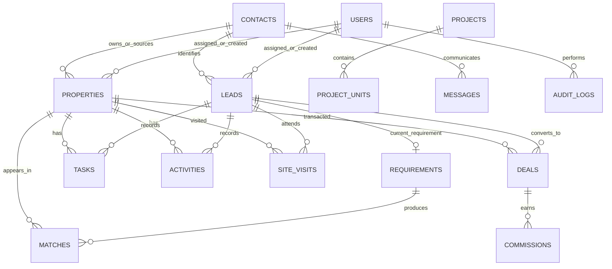

# Property OS V2 — Database Schema

The implementation uses SQLite with SQLAlchemy ORM. The schema is intentionally relational: a contact is not the same thing as a lead; a lead is not the same thing as a property; a match joins a requirement to a listing.

## Core entity map

## Implemented tables

### `users`
- `id` primary key
- `username` unique, indexed
- `full_name`
- `password_hash` (PBKDF2-SHA256; never store plaintext)
- `role` (`admin`, `manager`, `agent`)
- `is_active`, `created_at`

### `contacts`
- `id` primary key
- `name`, `phone` indexed, `email`, `company`
- `contact_kind` (`client`, `owner`, `broker`, etc.)
- `notes`, `created_at`

### `leads`
- `id`, unique `lead_code`, `contact_id` FK → contacts
- `lead_type`, `status`, `priority`, `source`
- `assigned_to` FK → users, `created_by` FK → users
- `notes`, `created_at`, `updated_at`

### `requirements`
- `id`, unique `lead_id` FK → leads (one current requirement in this initial implementation)
- `transaction_type`, `category`, `property_type`, `city`
- `preferred_locations` JSON array
- `min_budget`, `max_budget`, `stretch_budget` (INR numeric)
- `configuration`, `min_area_sqft`, `max_area_sqft`, `furnishing`
- `parking_required`, `amenities` JSON array
- `strict_location`, `strict_configuration`, `move_timeline`, `notes`

**Planned schema evolution:** support multiple versioned requirements per lead with `is_active`, `valid_from`, `valid_to`, and `supersedes_requirement_id`; do not overwrite historical preferences.

### `properties`
- `id`, unique `property_code`, `title`
- `transaction_type` (`sale`, `rent`), `category` (`residential`, `commercial`), `property_type`
- `city`, `locality`, `address`
- `price` numeric INR; for rental listings this is monthly rent
- `bhk`, `area_sqft`, `furnishing`, `floor`, `parking`, `amenities`
- `status`, `source_type`
- `owner_contact_id`, `source_contact_id` FKs → contacts
- `asking_commission`, `verified_at`, `notes`
- `created_by`, `assigned_to` FKs → users; `created_at`, `updated_at`

**Planned additional fields:** area basis, latitude/longitude, carpet/built-up/super-built-up area, price history, listing expiry, verification state and source-confidence score.

### `matches`
- `id`
- `requirement_id` FK → requirements
- `property_id` FK → properties
- unique constraint `(requirement_id, property_id)`
- `score` integer, `reasons` JSON array
- `status` (`new`, `approved`, `sent`, `rejected`, `shortlisted`)
- `calculated_at`

### `tasks`
- `id`, `title`, `description`, `due_at`, `priority`, `status`
- optional `lead_id` and `property_id` FKs
- `assigned_to`, `created_by`, `created_at`

### `activities`
- `id`, optional `lead_id`, `property_id`, `user_id`
- `activity_type`, `description`, `created_at`

### `site_visits`
- `id`, `lead_id`, `property_id`, `scheduled_at`, `status`, `feedback`, `created_by`

### `deals`
- `id`, unique `deal_code`, `lead_id`, `property_id`
- `stage`, `agreed_value`, `expected_close_date`, `closed_at`, `notes`, `created_by`

### `commissions`
- `id`, `deal_id`, `expected_amount`, `agreed_amount`, `received_amount`
- `status`, `due_date`, `received_at`

### `projects` and `project_units`
Project parent records with developer, location, RERA reference, category/status/possession and child configuration/unit inventory with ranges, unit counts, area and availability.

### `messages`
Contact-linked manual or external channel communication with direction, body, external ID and delivery status. This table does not require WhatsApp to operate.

### `audit_logs`
User, entity type/id, action, summary and timestamp. An audit viewer and more complete before/after payload are planned.

## Data conventions

- Primary keys are integer IDs; user-facing IDs are stable readable codes (`LD-YYYY-00001`, `PR-YYYY-00001`, `DL-YYYY-00001`).
- Store currency as numeric INR, not formatted strings.
- `NULL` means unknown or not supplied; do not infer false.
- Store date/time in ISO-compatible datetime fields; display in the user's local timezone.
- JSON is used only for small structured lists (locations, amenities, reasons). Core relations remain relational.
- Use foreign keys and `ON DELETE` behavior to prevent accidental orphaning. Archive important business records instead of deleting them.

## Migrations

The first foundation uses SQLAlchemy `create_all` for initial table creation. Before a production rollout with valuable data, add Alembic migrations and tested backup/restore. Do not manually change tables in a live database.
